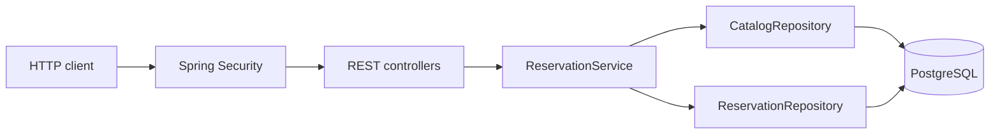

# ReserveHub

Backend для бронирования и выдачи оборудования: камеры, ноутбуки, проекторы и другая техника общего пользования.

**Java 21 · Spring Boot · Spring Security · Spring JDBC · SQL · PostgreSQL · Flyway · JUnit 5**

[](https://github.com/I-F-E-N-I-X-I/reservehub/actions/workflows/ci.yml)

Учебный проект среднего масштаба с серверной бизнес-логикой, REST API и транзакционной работой с базой данных. Код и документация подготовлены с помощью AI-ассистента; проект предназначен для изучения, проверки и дальнейшего самостоятельного развития. Подробности — в [описании разработки](docs/DEVELOPMENT.md).

## Что умеет

- Регистрация пользователей, хранение хешей паролей BCrypt, роли USER и ADMIN.
- Каталог оборудования с поиском, пагинацией и изменением количества администратором.
- Резервирование доступного количества с защитой от одновременного бронирования последней единицы.
- Выдача и возврат оборудования администратором, отмена собственного резерва пользователем.
- История переходов статуса с автором и временем изменения.
- Отчёт по статусам и количеству единиц; единый формат ошибок Problem Details.
- SQL-миграции, автоматические тесты, Docker Compose и GitHub Actions.

## Быстрый запуск без Docker

Нужен **JDK 21 или 25**. Maven Wrapper загрузит Maven и зависимости при первом запуске.

```bash
./mvnw verify
./mvnw spring-boot:run -Dspring-boot.run.profiles=demo
```

В Windows PowerShell:

```powershell
.\mvnw.cmd verify
.\mvnw.cmd spring-boot:run '-Dspring-boot.run.profiles=demo'
```

API: `http://localhost:8080`. Проверка запуска: `GET /actuator/health`.
Демо-администратор: `admin` / `demo-admin-password`. Демо-база H2 хранится в памяти и очищается после остановки. Эти реквизиты предназначены только для локального запуска.

## Запуск с PostgreSQL

Скопируйте `.env.example` в `.env`, задайте два разных пароля длиной от 12 символов и выполните:

```bash
docker compose up --build -d
docker compose logs -f api
```

В Windows копирование: `Copy-Item .env.example .env`. В Linux/macOS: `cp .env.example .env`.
API доступен только на localhost:8080. База не публикует порт наружу. Данные сохраняются в Docker volume.
Остановка с сохранением данных: `docker compose down`.

При запуске без Docker нужны `DB_URL`, `DB_USER`, `DB_PASSWORD`, `ADMIN_PASSWORD`.
Администратор создаётся только при отсутствии аккаунта; изменение переменной пароля не меняет пароль уже созданного пользователя.

## Пример сценария

Команды для Bash; в Windows можно выполнить [PowerShell-сценарий](scripts/demo.ps1).

```bash
# Создать обычного пользователя
curl -i localhost:8080/api/v1/users -H 'Content-Type: application/json' \
  -d '{"username":"alice","password":"alice-demo-password"}'

# Создать оборудование от имени администратора
curl -u admin:demo-admin-password localhost:8080/api/v1/equipment \
  -H 'Content-Type: application/json' \
  -d '{"name":"Camera Sony","description":"Camera with lens","quantity":2}'

# Забронировать одну единицу (подставьте id оборудования из ответа)
curl -u alice:alice-demo-password localhost:8080/api/v1/reservations \
  -H 'Content-Type: application/json' -d '{"equipmentId":1,"quantity":1}'

# Выдать и вернуть (подставьте id резерва)
curl -u admin:demo-admin-password -X POST localhost:8080/api/v1/admin/reservations/1/issue
curl -u admin:demo-admin-password -X POST localhost:8080/api/v1/admin/reservations/1/return

# Просмотреть историю
curl -u alice:alice-demo-password localhost:8080/api/v1/reservations/1/events
```

## Архитектура



Пакеты `identity`, `catalog`, `reservation`, `common` разделяют ответственность. Это модульно организованный монолит с одной базой. Он демонстрирует основу для обсуждения выделения сервисов, но не является готовой микросервисной системой. [Архитектура и компромиссы](docs/ARCHITECTURE.md).

Hibernate ORM/JPA не используется: SQL написан явно через Spring JDBC. Hibernate Validator в зависимостях реализует Bean Validation и не является Hibernate ORM.

## Проверки

```bash
./mvnw verify
```

Тесты проверяют матрицу статусов, авторизацию, валидацию, хеширование паролей, изоляцию пользовательских данных, откат транзакций, конкурентное резервирование и повторную отмену. CI повторяет тесты с настоящим PostgreSQL 17; локальные тесты по умолчанию используют H2.

Для запуска тестов с собственной отдельной PostgreSQL-базой задайте `TEST_DB_URL`, `TEST_DB_USER`, `TEST_DB_PASSWORD`. Тесты создают записи; не запускайте их на рабочей базе.

## Документация

- [REST API и коды ошибок](docs/API.md)
- [Архитектура, SQL и путь к микросервисам](docs/ARCHITECTURE.md)
- [Процесс разработки и план самостоятельной работы](docs/DEVELOPMENT.md)
- [Навыки и описание для портфолио](docs/PORTFOLIO.md)

## Границы проекта

Бронирование уменьшает доступный остаток сразу: календарные интервалы, сроки резерва и автоматическое истечение пока не реализованы. Нет платежей, email-уведомлений, frontend и JWT. Используется HTTP Basic для локального API; при внешнем размещении необходим HTTPS. CSRF отключён для серверного API без браузерного интерфейса: перед подключением браузерного клиента модель аутентификации и CSRF-защиту нужно пересмотреть. Rate limiting и восстановление пароля оставлены за рамками учебного проекта.
