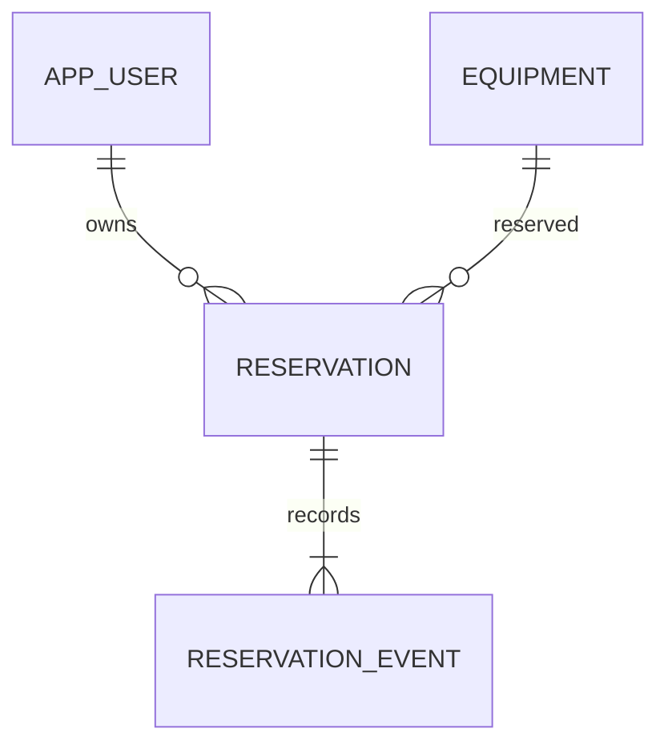
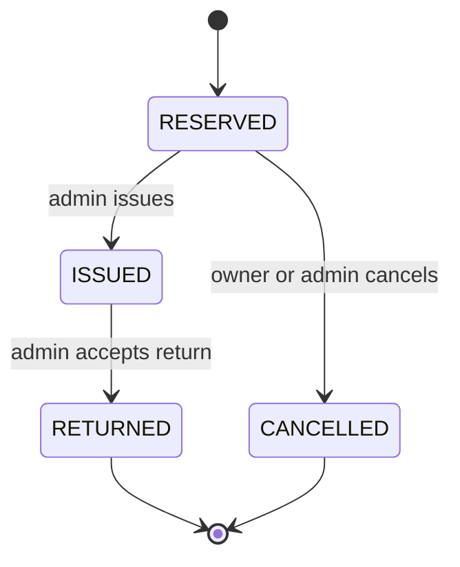

# Архитектура ReserveHub

## Предметная область

Одна запись equipment описывает группу взаимозаменяемых предметов. `total_quantity` — общее количество, `available_quantity` — свободное. Резерв хранит пользователя, оборудование, количество и статус. События хранят последовательность изменений отдельно от текущего состояния.



## Жизненный цикл



При RESERVED свободное количество уменьшается. ISSUED не меняет остаток; CANCELLED и RETURNED возвращают его. Все другие переходы дают HTTP 409. Терминальные операции намеренно не идемпотентны на уровне HTTP: повтор возвращает 409, но не повторяет эффект. POST создания резерва без idempotency key нельзя автоматически повторять при сетевой неопределённости.

## Конкурентный доступ

Опасный подход — сначала прочитать остаток, а затем отдельно вычесть количество. Два запроса могут прочитать одно и то же значение. Вместо этого применяется условный SQL:

```sql
UPDATE equipment
SET available_quantity = available_quantity - :quantity
WHERE id = :id AND available_quantity >= :quantity;
```

Если обновлено 0 строк, позиции нет (404) либо свободного количества недостаточно (409). Обновление строки сериализует конкурирующие изменения в PostgreSQL. Создание резерва и запись аудита находятся в одной `@Transactional` операции с изменением остатков.

При смене статуса `SELECT ... FOR UPDATE` блокирует строку резерва до завершения транзакции. Второй параллельный запрос после ожидания видит новый статус и не возвращает количество повторно. Для каждого бизнес-действия изменяется только одна позиция оборудования. При расширении на корзину потребуется фиксированный порядок захвата блокировок и обработка deadlock/retry.

## Схема и ограничения

Flyway применяет версионируемую миграцию. Внешние ключи защищают связи. CHECK-ограничения запрещают отрицательные остатки, доступное количество выше общего, недопустимые роли и статусы. UNIQUE защищает имя пользователя. Индексы ускоряют получение резервов владельца и истории конкретного резерва. Поиск `LIKE '%text%'` удобен для небольшого каталога; для большого стоит рассмотреть PostgreSQL trigram-индекс.

## Безопасность

Роли назначаются сервером: публичная регистрация создаёт USER. Неизвестные JSON-поля отклоняются. Пароли хранятся через BCrypt, хеш не включается в ответы. Пользователь видит только собственные резервы; чужой id возвращает 404. ADMIN управляет каталогом и выдачей. SQL-параметры передаются через JDBC placeholders, а не конкатенируются с пользовательскими значениями.

Параметры пагинации ограничены: limit 1–100, offset от 0. HTTP Basic рассчитан на локальные демонстрационные запросы. Для внешнего сервиса нужны TLS, ограничение частоты запросов, управление секретами, восстановление пароля и отдельное решение для браузерной безопасности.

## Почему Spring JDBC

В проекте важно явно показать SQL, ограничения базы, транзакции и блокировки. Hibernate ORM не требуется. Возможный следующий шаг — реализовать альтернативный persistence-слой через JPA и сравнить SQL, поведение блокировок и сложность.

## Путь к микросервисам

Текущее приложение — один процесс и одна транзакционная база. Разделение на сервисы здесь не даёт достаточной выгоды и усложняет гарантии остатков.

Первым независимым сервисом могли бы стать уведомления. Надёжный вариант — transactional outbox: основная транзакция записывает событие в outbox, отдельный publisher доставляет его в очередь, обработчик устраняет дубли по event id. Текущий журнал событий не является готовым outbox: у него нет доставки, повторов и состояния публикации.

При выделении каталога и резервирования понадобятся отдельные базы, команды резервирования, идемпотентность и компенсирующие действия (saga). Общая JDBC-транзакция между сервисами перестанет работать. Эти механизмы описаны как план, а не как реализованные возможности.
